# MIRROR --- Complete Product Discussion & Codex Hackathon Brief

**Project:** MIRROR --- Meet Your Future Self\
**Context:** Codex Community Dev Hackathon, London\
**Discussion date:** 1 November 2026\
**Purpose:** Consolidated record of the product idea, founder
interrogation, decisions, product direction, MVP, technical architecture
and Codex handoff.

------------------------------------------------------------------------

# 1. Original idea

The founder is taking part in the Codex Community Dev Hackathon in
London and wants to build a persona for people using ChatGPT or related
services.

The proposed persona would:

-   Appear in the user's interface, ideally in a screen corner.
-   Be movable anywhere on the screen.
-   Be created from a current photograph supplied by the user.
-   Age in step with the user over time.
-   Offer controls to preview how the user might look after one, five,
    ten, fifteen or more years. A plus-button or timeline interaction
    could expose additional future ages.
-   Reflect plausible physical changes, such as hair loss, changes in
    body composition, posture and facial ageing.
-   Change facial expression or body language in a scenario, while
    avoiding assumptions that a particular body type or physical trait
    necessarily means someone is unhappy.
-   Include an AI button that suggests practical changes to diet,
    exercise, lifestyle, grooming or styling.
-   Collect onboarding information such as daily routine, diet, exercise
    plan, current and historical photographs and other relevant details.
-   Build a useful personal memory over time.

Potential technologies mentioned in the original idea included
image-generation models, Three.js, decision models and other suitable
services.

The original request was to challenge the idea rigorously and help shape
it into a hackathon product.

------------------------------------------------------------------------

# 2. Product reframing

The idea was reframed from "an AI avatar that shows how you will age"
into:

> **A personal future-self simulator: an AI companion that lets people
> explore plausible consequences of lifestyle choices and consider how
> they might shape their future.**

This distinction matters. A photograph and questionnaire cannot
scientifically predict exactly how a particular person will look in 15
years. The product should generate clearly labelled, illustrative
scenarios based on stated assumptions---not claim to make medical or
deterministic predictions.

The working product name is **MIRROR**.

## Positioning

**MIRROR --- Meet the person you're becoming. Decide who you want to
be.**

Alternative tagline:

**Meet your future self.**

The product should not shame users or use fear of ageing, weight gain,
baldness or other physical traits as a motivator. It should help users
explore possibilities and make informed choices.

------------------------------------------------------------------------

# 3. Initial product pillars

Three product directions were considered:

## A. Personal AI companion

A floating digital human that is available in the user's interface,
understands their profile and habits, and can interact with them.

## B. Future-self simulator

A user uploads a photograph and explores plausible future appearances at
different ages and under different lifestyle assumptions.

## C. Personal transformation coach

The system helps users understand their habits and offers practical,
personalised suggestions around nutrition, exercise, sleep, lifestyle
and grooming.

## Recommended product direction

Combine all three, with the **future-self simulator as the initial
hook**:

-   Users arrive because they want to see a possible future version of
    themselves.
-   They stay because the persona is an engaging companion.
-   They receive ongoing value through useful, non-judgemental
    suggestions and progress tracking.

------------------------------------------------------------------------

# 4. Founder interrogation --- Round 1

The initial questions explored the target audience, product experience,
future simulation, persona behaviour, technical risks and retention.

## Questions asked

### Target audience and problem

1.  Why would someone want this persona on their screen every day?
2.  Is the primary motivation curiosity, self-improvement, health,
    appearance, motivation or accountability?
3.  What would make someone open ChatGPT specifically to interact with
    this persona?
4.  What would make someone use it for more than three days?
5.  Should it motivate through fear of a future appearance or excitement
    about potential?
6.  What happens if someone does not care about appearance?

### Persona design

1.  Should the persona be realistic or stylised?
2.  Should it look like the uploaded photograph?
3.  Should it be full-body or face-only?
4.  Should users change clothes, hairstyle, facial hair and accessories?
5.  Should it express emotions in response to decisions?
6.  Should it proactively communicate?

### Ageing and transformation

1.  Should every future image be generated from the original photograph,
    or should each version build on the previous one?
2.  How will facial identity be maintained across years of progression?
3.  Can the AI distinguish genetic hair loss from lifestyle-related
    changes?
4.  Should users explore healthy and unhealthy scenarios?
5.  What if the user has a medical condition affecting physique?
6.  How can unrealistic transformations be avoided?

### AI intervention

The proposed AI intervention categories were:

-   Nutrition and food recommendations.
-   Fitness and workout planning.
-   Grooming, hair and styling.
-   Lifestyle, sleep and habits.

A key product principle was established: an image-generation model
should not decide what diet or medical treatment a person needs.
Recommendations should come from a separate reasoning and knowledge
layer. Clinical interventions such as hair transplantation or medication
should be options to discuss with qualified professionals, not automatic
prescriptions from an avatar.

------------------------------------------------------------------------

# 5. Initial founder answers

The founder answered the first interrogation as follows:

  -----------------------------------------------------------------------
  Question                            Founder decision
  ----------------------------------- -----------------------------------
  Primary target user                 Anyone using ChatGPT

  Core experience                     Floating 3D digital human,
                                      realistic future-self simulator and
                                      interactive AI companion---all
                                      integrated

  Future representation               Multiple scenarios based on
                                      lifestyle choices

  User information                    Photographs, age and lifestyle
                                      questionnaire

  Product location                    Mobile app and desktop companion

  Hackathon ambition                  Impressive visual demo with a
                                      functioning AI backend

  Product direction                   Challenge assumptions and suggest a
                                      better direction
  -----------------------------------------------------------------------

## Strategic challenge to those answers

"Anyone using ChatGPT" is a potential long-term audience, not a
sufficiently focused launch segment.

The recommended initial audience is people who are curious about their
future appearance and motivated to improve aspects of their lifestyle.
The product can expand later.

Building a mobile app, desktop companion, full 3D human,
image-generation system, scenario engine and persistent AI memory all at
once is too much for a short hackathon.

The recommended approach is to build one polished end-to-end experience
in a responsive web application. This can be demonstrated on desktop and
mobile without building two separate applications.

------------------------------------------------------------------------

# 6. The future-self experience

The proposed onboarding and main product journey:

1.  User uploads a current photograph.
2.  User provides age and relevant lifestyle information.
3.  MIRROR creates a recognisable digital representation.
4.  User selects a future age, such as +5, +10 or +15 years.
5.  User explores multiple lifestyle scenarios.
6.  User compares possible outcomes.
7.  User asks the future-self companion for practical suggestions.
8.  The application stores the user's profile, scenarios and
    progress---with explicit consent and privacy controls.

## Main application areas

1.  **Create** --- Build the initial persona.
2.  **Explore** --- See future versions of the user.
3.  **Compare** --- Compare different lifestyle scenarios.
4.  **Improve** --- Ask the future self for advice.

The floating companion should provide persistent access to these
experiences.

------------------------------------------------------------------------

# 7. Multiple future timelines

A major product idea was to offer multiple possible futures rather than
a single prediction.

Example: a user currently aged 35 explores their appearance at age 50.

### Scenario A --- Active lifestyle

Assumptions might include consistent exercise, balanced nutrition and
adequate sleep.

### Scenario B --- Current habits

The user's current stated habits continue.

### Scenario C --- Less active lifestyle

The user explores a hypothetical scenario involving lower activity or
less supportive habits.

The system should show three possible visualisations and explain the
assumptions behind each one.

These are illustrative scenarios, not scientifically validated
predictions. A person's appearance is affected by many factors,
including genetics, health, environment and chance. The system must not
imply that a particular lifestyle guarantees a particular appearance.

## Important interaction

A potentially compelling interaction:

-   User sees a future scenario.
-   User changes one lifestyle variable, such as exercise frequency.
-   MIRROR generates an alternative scenario.
-   The user compares the two outcomes and receives practical
    suggestions.

This "change one decision and see another possible future" interaction
is a proposed central hackathon demonstration moment.

------------------------------------------------------------------------

# 8. Ageing, physical changes and emotional representation

Three types of visual change were separated.

## A. Natural ageing

Potential visual elements:

-   Skin texture and wrinkles.
-   Hair greying.
-   Hairline changes.
-   Age-associated facial changes.
-   Plausible changes in body composition.

## B. Lifestyle-associated changes

Potential elements:

-   Weight and body composition.
-   Muscle development.
-   Posture.
-   General appearance.
-   Possible effects associated with sleep, smoking and sun exposure.

The system should be cautious: it cannot infer precise health outcomes
from a photo or lifestyle questionnaire.

## C. Expressions and body language

Potential elements:

-   Facial expression.
-   Posture.
-   Energy or mood representation.
-   Body gestures.
-   Confidence or demeanour, where the user has chosen that tone.

Important correction: a person who gains weight is not necessarily
unhappy; a bald person is not necessarily tired; an older person is not
necessarily unhealthy. Physical traits must not be automatically mapped
to negative emotions.

The persona's expression should reflect the selected scenario's stated
mood or energy assumptions---not stereotypes about body size, baldness
or age.

## Identity consistency

For the hackathon, generate each future image from the original
photograph as the identity reference rather than chaining one generated
image into the next. Chaining can compound identity drift.

The product should preserve the user's recognisable identity as far as
the chosen image model allows, while being transparent that consistency
is imperfect.

------------------------------------------------------------------------

# 9. The AI future-self companion

The persona should feel like a supportive companion, not a judgemental
health inspector.

Example interaction:

**User:** I'm going to skip my workout today.

**Future self:** That's okay. We've skipped a few sessions this week.
Would a 15-minute walk feel more manageable?

Another example:

**User:** Show me what I might look like in 15 years if I continue this
lifestyle.

**Future self:** I can show you a hypothetical scenario based on your
current habits. We can also explore what might change if you introduced
regular exercise and improved your sleep.

The AI should:

-   Understand the user's profile and goals.
-   Explain the assumptions behind future scenarios.
-   Suggest realistic improvements.
-   Offer nutrition, activity, sleep and grooming guidance.
-   Remember relevant prior interactions when persistence is enabled.
-   Be friendly, supportive and non-judgemental.
-   Avoid diagnosing medical conditions or prescribing treatment.

------------------------------------------------------------------------

# 10. Memory and personal history

MIRROR could become a visual diary of the user's life.

Potential memory entries:

-   Weight or other user-provided measurements over time.
-   Previous workout routines.
-   Dietary habits.
-   Hairstyle and appearance photographs.
-   Lifestyle changes.
-   Personal goals.
-   What the user tried and what they found useful.
-   Scenario history and user feedback.

Example timeline:

-   January: Started exercising twice a week.
-   March: Increased to four sessions a week.
-   June: Changed dietary habits.
-   December: Reviewed one year of progress.

The product should not silently create a permanent record of someone's
face or health. Consent, encryption, deletion, retention limits and
private-by-default storage are important from the beginning.

------------------------------------------------------------------------

# 11. Floating persona and platform strategy

The original concept calls for a small movable persona in a screen
corner.

For the hackathon:

-   Build a draggable React component inside the MIRROR application.
-   Allow it to be minimised and expanded.
-   Clicking it should open the AI conversation.
-   It should display the current persona.
-   Add a simple animated or expressive state if feasible.

Do not spend hackathon time trying to inject the persona into ChatGPT's
native interface. MIRROR does not control that interface.

A browser extension or native desktop companion can be a later phase. A
responsive web app is the fastest way to demonstrate both desktop and
mobile layouts.

## Possible future behaviour

The companion might:

-   Remain quiet until clicked.
-   Show a reminder or thought occasionally.
-   React to milestones.
-   Offer proactive suggestions.
-   Celebrate progress.

The exact behaviour and notification frequency remain product decisions.

------------------------------------------------------------------------

# 12. Technical architecture

The technical options discussed included:

  -----------------------------------------------------------------------
  Layer                               Technology candidates
  ----------------------------------- -----------------------------------
  Frontend                            React / Next.js

  Language                            TypeScript

  Styling                             Tailwind CSS

  3D persona                          Three.js / React Three Fiber

  Image understanding                 Gemini vision model or a
                                      vision-capable OpenAI model

  Image generation                    Gemini image generation or another
                                      suitable image provider

  Conversation                        GPT / Gemini

  Decision engine                     Rules + LLM + structured user data

  Database                            Supabase / PostgreSQL

  File storage                        Supabase Storage or equivalent

  Authentication                      Supabase Auth

  Memory                              Structured profile + event history

  Scheduling                          Daily background job, if needed
                                      later
  -----------------------------------------------------------------------

These are candidates, not fixed dependencies. Codex should inspect the
repository and verify current APIs, model capabilities, pricing and
credentials before selecting integrations.

## Recommended architecture principles

-   Separate image generation from scenario reasoning.
-   Use a structured decision engine to create scenario assumptions.
-   Use the image model to render those assumptions.
-   Use an LLM for conversation and explanations.
-   Keep model providers behind replaceable interfaces.
-   Never expose API keys in frontend code.
-   Generate future images on demand rather than regenerating the
    persona daily.
-   Store the original identity reference and scenario metadata.
-   Make user data private and access-controlled.

## Daily ageing clarification

The persona's displayed calendar age can update daily. Its physical
appearance should not visibly transform every 24 hours.

Physical appearance should change when the user updates their lifestyle
information, selects a new scenario or uploads a new photograph.

------------------------------------------------------------------------

# 13. Two approaches to future appearance generation

## Approach A --- Direct image generation

Input:

-   Original photograph.
-   Target age.
-   Structured lifestyle scenario.
-   Visual instructions.

Output:

-   A generated future portrait or image.

Advantages:

-   Fastest route to a compelling hackathon demo.
-   Visually impressive.
-   No need to build a full 3D character system.

Limitations:

-   Identity consistency may be imperfect.
-   Fine-grained control over physical transformations is limited.
-   Generated images do not automatically become animatable 3D models.

**Recommendation: Use this for the hackathon MVP.**

## Approach B --- Structured 3D digital human

Pipeline:

Photograph → identity modelling → 3D avatar → parameters controlling
age, body and expression.

Advantages:

-   More interactive control.
-   Can support gestures and animation.
-   Better long-term potential for an animated companion.

Limitations:

-   More engineering work.
-   Requires suitable identity modelling, rigging and rendering.
-   Not necessary to prove the core product concept.

**Recommendation: Treat this as a stretch goal or later product phase.**

A generated photograph is not a rigged 3D human. These should be treated
as separate technical capabilities.

------------------------------------------------------------------------

# 14. Example scenario-engine structure

The scenario engine should produce structured assumptions before image
generation.

Example:

``` json
{
  "scenario": "active_lifestyle",
  "future_age": 50,
  "assumptions": {
    "exercise": "4 sessions per week",
    "nutrition": "balanced diet",
    "sleep": "7-8 hours"
  },
  "visual_changes": [
    "plausible natural ageing",
    "possible changes in body composition",
    "age-appropriate hair changes"
  ]
}
```

This is an illustrative schema, not a scientific model. The actual
system should validate its inputs and avoid claiming that these
assumptions determine an exact future appearance.

------------------------------------------------------------------------

# 15. Round 2 founder interrogation

The following questions were raised for the next product decision round.
They have **not yet been answered**.

## 1. What makes MIRROR different from asking ChatGPT to generate an aged photograph?

Proposed differentiators:

-   Persistent identity.
-   Multiple timelines.
-   Lifestyle-aware scenarios.
-   Interactive companion.
-   Memory and progress history.

Founder decision still needed.

## 2. How should the persona behave?

Possible behaviours:

-   Speak like the user's future self.
-   Speak like a friendly AI assistant.
-   Occasionally initiate conversations.
-   React to user activity.
-   Have its own personality.

Initial recommendation: a friendly future-self personality that can
switch between supportive, reflective and motivational.

Founder decision still needed.

## 3. How realistic should the persona be?

Options:

-   Photorealistic.
-   Stylised 3D human.
-   Photorealistic face with a 3D animated body.

Founder decision still needed.

## 4. Should users be able to change their future?

Example: a user changes exercise frequency from once to four times
weekly and immediately generates a new future scenario.

Recommendation: yes. This could be the product's signature interaction.

Founder decision still needed.

## 5. What should the floating persona do when not being used?

Options:

-   Stay in the corner.
-   Occasionally show a thought or reminder.
-   React to milestones.
-   Offer proactive suggestions.
-   Remain silent until clicked.

Founder decision still needed.

## 6. How should mobile and desktop differ?

Options:

-   Identical interface on both.
-   Desktop has a floating companion; mobile has a compact interactive
    avatar.
-   Responsive layouts with shared functionality.

Founder decision still needed.

## Additional founder question

If a judge remembers only one thing after watching the demo, what should
it be?

Proposed answer:

> "I uploaded one photograph, met three possible versions of myself 15
> years from now, changed one lifestyle decision, and watched my future
> change."

------------------------------------------------------------------------

# 16. Recommended hackathon MVP

The goal is a polished, demonstrable prototype with a functioning AI
backend---not a complete long-term product.

## Essential features (P0)

1.  Landing page.
2.  Onboarding questionnaire.
3.  Photograph upload.
4.  AI persona generation.
5.  Future age selection.
6.  Alternative scenario generation.
7.  Scenario comparison.
8.  AI companion interaction.

## Important features (P1)

9.  Draggable floating persona.
10. Persistent profile.
11. Polished loading states.
12. Error handling and useful fallback states.

## Stretch features (P2)

13. 3D avatar.
14. Animated facial expressions.
15. Proactive reminders.
16. Daily ageing and long-term tracking.

Do not sacrifice P0 features to build P2 features.

## Recommended age controls

-   Current appearance.
-   +5 years.
-   +10 years.
-   +15 years.

## Recommended scenario controls

-   Active lifestyle.
-   Current habits.
-   Less active lifestyle.

The user should be able to compare these scenarios and understand the
assumptions behind each.

------------------------------------------------------------------------

# 17. Proposed hackathon demo story

The demonstration should tell one coherent story.

## Scene 1 --- Create yourself

Upload a photograph. MIRROR creates a digital identity.

## Scene 2 --- Meet your future

Select 15 years. See a plausible version of your future appearance.

## Scene 3 --- Change your choices

Change diet or exercise assumptions. Generate another possible future.

## Scene 4 --- Talk to your future self

The future persona explains what lifestyle changes could help the user
work towards their goals.

## Scene 5 --- Keep moving forward

The companion remains accessible and remembers progress, subject to user
consent.

## Suggested three-minute pitch

The core story is:

> "Meet the person you're becoming. Decide who you want to be."

The strongest demonstration moment is the user changing one lifestyle
decision and seeing a different possible future appear.

------------------------------------------------------------------------

# 18. Codex handoff --- Master implementation prompt

The following prompt was prepared to paste into a Codex session.

------------------------------------------------------------------------

# CODEX MASTER PROMPT --- MIRROR

## Build an AI-powered Future Self Simulator

You are my technical co-founder, principal software architect, senior
frontend engineer, AI engineer and product designer.

We are building MIRROR for a developer hackathon.

Your responsibility is to help me deliver a polished, impressive,
functioning prototype with real AI capabilities.

Do not just generate code. Think like a product engineer. Challenge poor
technical decisions, identify shortcuts, and prioritise what will make
the demonstration exceptional.

## 18.1 Product vision

MIRROR is an AI-powered personal future-self simulator.

It creates a digital representation of a person using their photograph,
age and lifestyle information.

Users can:

-   See their current digital persona.
-   Fast-forward their appearance by 5, 10 or 15 years.
-   Explore multiple possible futures based on lifestyle choices.
-   Compare alternative versions of themselves.
-   Interact with their future self through an AI companion.
-   Receive personalised lifestyle, nutrition, fitness and grooming
    suggestions.
-   Maintain a structured history of their goals and progress.

Core positioning:

"Meet the person you're becoming. Decide who you want to be."

The product should feel premium, futuristic, personal and emotionally
engaging.

## 18.2 Target experience

Build a responsive web application that works on desktop and mobile.

The application should have five major experiences:

1.  Onboarding.
2.  Digital persona creation.
3.  Future timeline exploration.
4.  Lifestyle scenario comparison.
5.  AI future-self companion.

## 18.3 Onboarding

Create an elegant onboarding experience.

Collect:

-   Name or preferred display name.
-   Age.
-   Current photograph.
-   Optional historical photographs.
-   Daily routine.
-   Diet and eating habits.
-   Exercise frequency.
-   Sleep patterns.
-   Lifestyle habits.
-   Personal goals.

Keep the questionnaire conversational and easy to complete.

Allow users to skip optional questions.

Clearly explain why photographs and personal information are being
collected.

## 18.4 Digital persona

Create a visually recognisable representation of the uploaded person.

Requirements:

-   Preserve facial identity as closely as the chosen image-generation
    technology allows.
-   Generate a high-quality portrait.
-   Maintain the original photograph as the identity reference.
-   Support future age transformations.
-   Support different lifestyle scenarios.
-   Avoid unnecessary changes to ethnicity, facial structure or
    identity.

Do not pretend a generated image is a fully rigged 3D model.

Start with photorealistic image generation. Build animated 3D features
only if time permits.

## 18.5 Future-self engine

Allow users to select:

-   Current appearance.
-   +5 years.
-   +10 years.
-   +15 years.

Generate three hypothetical scenarios:

A. Active lifestyle.\
B. Continuation of current habits.\
C. Less active lifestyle.

Each scenario should use structured lifestyle assumptions.

Generate future appearances using the original photograph as the
identity reference rather than chaining previously generated images.

The output should account for plausible natural ageing and
scenario-specific visual changes.

Do not claim to predict someone's actual appearance or health.

Maintain identity consistency as far as technically possible.

## 18.6 Lifestyle decision engine

Create a structured scenario engine.

Inputs:

-   Age.
-   Exercise frequency.
-   Nutrition habits.
-   Sleep patterns.
-   Lifestyle habits.
-   User goals.
-   Selected future age.

Outputs:

-   Scenario description.
-   Lifestyle assumptions.
-   Plausible visual changes.
-   Wellness recommendations.
-   Image-generation instructions.

Separate scenario reasoning from image generation.

Use structured JSON responses wherever practical.

Avoid allowing an image-generation model to independently invent health
assessments.

## 18.7 AI future-self companion

Build a conversational AI companion.

The companion should:

-   Speak in a friendly, supportive manner.
-   Understand the user's lifestyle profile.
-   Explain different future scenarios.
-   Suggest realistic improvements.
-   Recommend appropriate nutrition and exercise habits.
-   Discuss grooming and styling options.
-   Remember previous interactions where persistence is enabled.

Example:

User: What happens if I continue my current lifestyle for 15 years?

MIRROR: I can show you a hypothetical scenario based on your current
habits. Would you also like to explore what could change if you
introduced regular exercise and improved your sleep?

The AI must not diagnose medical conditions or prescribe treatments.

## 18.8 Floating persona

Create a draggable floating companion component.

Requirements:

-   Appears in a corner of the application.
-   Can be dragged anywhere within the viewport.
-   Can be minimised and expanded.
-   Opens the AI conversation when clicked.
-   Displays the current persona.
-   Supports a simple animated or expressive state if feasible.

This must work inside our application. Do not spend hackathon time
trying to inject it into ChatGPT's native interface.

## 18.9 Visual design

Design direction:

-   Premium futuristic interface.
-   Dark background with restrained gradients.
-   Glass-like panels.
-   High-quality human portraits.
-   Smooth transitions.
-   Minimal visual clutter.
-   Excellent typography.
-   Responsive layouts.
-   Beautiful scenario comparison screens.

Avoid generic SaaS dashboard design.

The human persona should be the visual centrepiece.

The interface should look like a product someone would genuinely want to
use.

## 18.10 Technical architecture

Evaluate the existing project before selecting technologies.

Preferred stack:

Frontend: - React. - Next.js. - TypeScript. - Tailwind CSS.

Visualisation: - Three.js / React Three Fiber, if useful. - CSS
animations for the initial companion.

AI: - Vision-capable LLM for image understanding where needed. - Gemini
image generation or another available image-generation provider. - LLM
for conversational interaction. - Structured decision engine.

Backend: - Supabase. - PostgreSQL. - Supabase Storage, if appropriate.

Use provider abstractions so image-generation and conversational AI
providers can be changed without rewriting the application.

Do not assume a particular model is available. Verify available APIs,
documentation and credentials.

Do not expose API keys in frontend code.

## 18.11 Data model

Design a sensible initial schema covering:

### User profile

-   ID.
-   Display name.
-   Age or date of birth.
-   Lifestyle information.
-   Goals.
-   Created timestamp.

### Photographs

-   User ID.
-   Storage reference.
-   Photograph type.
-   Upload timestamp.
-   Consent status.

### Personas

-   User ID.
-   Identity reference.
-   Current persona image.
-   Created timestamp.

### Scenarios

-   User ID.
-   Target age.
-   Scenario type.
-   Lifestyle assumptions.
-   Generated image.
-   Creation timestamp.

### Interactions

-   User ID.
-   Conversation history.
-   Relevant profile updates.
-   Timestamp.

Use secure access controls and user-level data isolation.

Avoid storing sensitive photographs or health-related information
unnecessarily.

## 18.12 Hackathon priorities

### P0 --- Must work

1.  Landing page.
2.  Onboarding questionnaire.
3.  Photograph upload.
4.  AI persona generation.
5.  Future age selection.
6.  Alternative scenario generation.
7.  Scenario comparison.
8.  AI companion interaction.

### P1 --- Important

9.  Draggable floating persona.
10. Persistent profile.
11. Beautiful loading states and error handling.

### P2 --- Stretch

12. 3D avatar.
13. Animated facial expressions.
14. Proactive reminders.
15. Daily ageing and long-term tracking.

Do not sacrifice P0 features to build P2 features.

## 18.13 Engineering rules

-   Inspect the existing repository before making changes.
-   Preserve working code.
-   Use TypeScript.
-   Keep components modular.
-   Use reusable UI components.
-   Validate API inputs and outputs.
-   Handle API failures gracefully.
-   Add loading and empty states.
-   Never expose secrets.
-   Do not hardcode fake AI responses while claiming the AI is
    functional.
-   If credentials are unavailable, provide a clearly labelled demo
    mode.
-   Do not introduce unnecessary dependencies.
-   Test the main user journey.
-   Maintain a working application throughout development.

## 18.14 First task

Before writing code:

1.  Inspect the repository and its existing structure.
2.  Identify available technologies and dependencies.
3.  Identify available API integrations and environment variables
    without exposing secrets.
4.  Propose the architecture.
5.  Identify the fastest reliable image-generation integration.
6.  Identify technical risks.
7.  Propose the implementation sequence.
8.  Estimate which features can realistically be completed during the
    hackathon.

Present a concise implementation plan.

Then execute the implementation in logical stages. Do not wait for
approval between every small task.

If an essential credential or technical dependency is missing, explain
the blocker and implement a working alternative where possible.

Our objective is to finish with a visually impressive, demonstrable
product, not just a collection of code files.

Start by inspecting the repository.

------------------------------------------------------------------------

# 19. Additional Codex prompts

Use these after the initial implementation.

## Prompt A --- Make the interface exceptional

``` text
Act as a world-class product designer. Review the entire MIRROR application. Improve its visual hierarchy, typography, transitions, spacing, responsive behaviour and overall experience. Make the future-self persona the centrepiece. Avoid generic dashboard aesthetics. Prioritise visual impact for a live hackathon demonstration. Do not break existing functionality.
```

## Prompt B --- Improve AI identity consistency

``` text
Review the image-generation pipeline. Our biggest challenge is maintaining the same person's identity across multiple future ages and lifestyle scenarios. Evaluate the available image-generation models and their reference-image capabilities. Implement the best practical approach, preserving the original photograph as the identity reference for every scenario. Add appropriate error handling and clearly distinguish generated simulations from predictions.
```

## Prompt C --- Prepare the hackathon demo

``` text
Act as a hackathon judge. Test the complete MIRROR user journey. Identify broken features, visual inconsistencies, slow API calls, poor loading states and unreliable integrations. Fix critical problems. Prepare a reliable 3-minute demonstration sequence and identify the three strongest product differentiators.
```

------------------------------------------------------------------------

# 20. How to work with Codex

Recommended implementation stages:

1.  **Architecture:** Give Codex the master prompt. Let it inspect the
    repository and propose the architecture.
2.  **Build the experience:** Get the landing page, onboarding, persona
    screen and timeline working before connecting all AI services.
3.  **Connect image generation:** Integrate the image-generation API and
    test it with an actual photograph that you have permission to use.
4.  **Build the scenario engine:** Generate three distinct future
    scenarios from structured lifestyle assumptions.
5.  **Add the companion:** Connect the LLM, persona memory and draggable
    interface.
6.  **Polish the demo:** Test the entire journey, fix loading issues and
    prepare a reliable demonstration.

## Codex working principles

-   Ask Codex to inspect the existing project before making changes.
-   Do not let it rewrite working infrastructure unnecessarily.
-   Ask it to identify missing API credentials early.
-   Prefer real integrations over fake responses.
-   If a real integration is blocked, clearly label any demo-mode
    behaviour.
-   Keep a working application throughout development.
-   Prioritise the end-to-end demo journey over ambitious stretch
    features.

------------------------------------------------------------------------

# 21. Outstanding setup questions

Before finalising the implementation plan, the founder needs to answer:

### 1. What is currently open in Codex?

-   An existing project/repository.
-   An empty project.
-   No project created yet.

### 2. Which AI API keys are available?

-   No API keys yet.
-   Gemini.
-   OpenAI.
-   Both Gemini and OpenAI.

### 3. How much time remains before submission?

-   Less than 3 hours.
-   Less than 6 hours.
-   6--12 hours.
-   More than 12 hours.

These answers determine the realistic implementation sequence and model
choices.

------------------------------------------------------------------------

# 22. Final product principles

The following principles should remain true throughout development:

1.  **Future, not fate:** MIRROR shows hypothetical scenarios, not
    certain predictions.
2.  **Identity matters:** Preserve the user's recognisable identity as
    far as possible.
3.  **Agency over fear:** Help users explore choices without shaming
    them.
4.  **No stereotypes:** Do not infer unhappiness, poor health or low
    confidence from age, baldness or body size.
5.  **Separate reasoning from rendering:** A decision engine creates
    scenario assumptions; an image model renders them.
6.  **Privacy by design:** Obtain consent and protect photographs and
    personal information.
7.  **Honest AI:** Do not claim medical validity or scientific
    prediction where none exists.
8.  **Build the magic first:** The most important moment is seeing a
    different possible future after changing one decision.
9.  **Keep scope disciplined:** A polished responsive web MVP is better
    than several incomplete native and 3D experiences.
10. **Make it emotionally memorable:** The product should inspire
    curiosity, agency and constructive action.

------------------------------------------------------------------------

# 23. Current status and next step

**Agreed:** The product direction, initial MVP, broad technical
approach, hackathon demonstration story and Codex master prompt.

**Not yet decided:** The six Round 2 persona/product behaviour questions
and the three Codex setup questions.

**Immediate next action:** Paste the Codex Master Prompt into the open
Codex session. Ask Codex to inspect the repository and report its
architecture and implementation plan before it starts making changes.

The hackathon's central demonstration should be:

> Upload one photograph. Meet three possible versions of yourself 15
> years from now. Change one lifestyle decision. Watch another possible
> future appear.

**MIRROR --- Meet the person you're becoming. Decide who you want to
be.**


---

# Visual reference pack

These are **concept references**, not final production UI or validated product behaviour.
Use them to guide visual direction and component hierarchy; do not copy inaccurate sample
data or imply that generated future appearances are scientifically predictive.

## Overall product direction

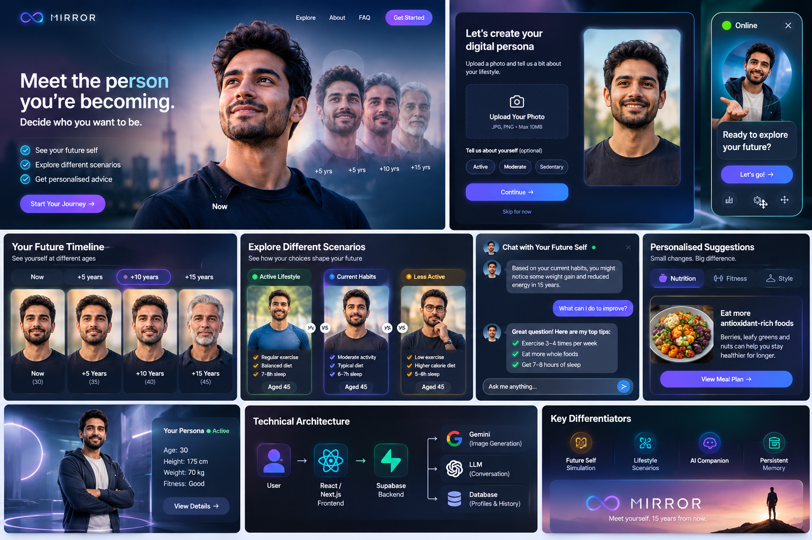

## Interface and experience references

### 1. Landing page and core promise
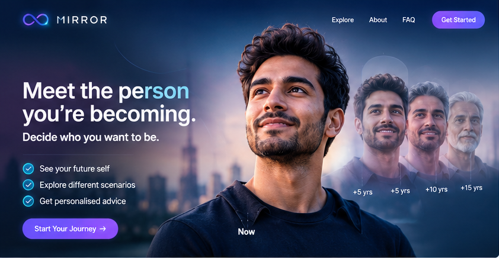

### 2. Persona onboarding and photo upload
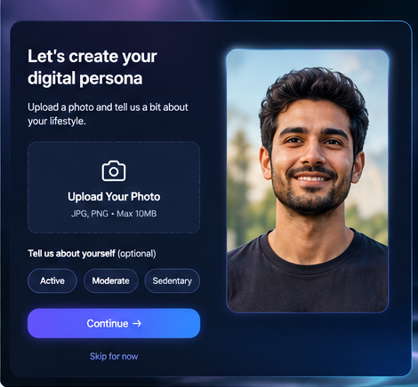

### 3. Floating future-self companion
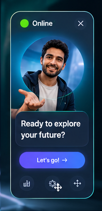

### 4. Future timeline
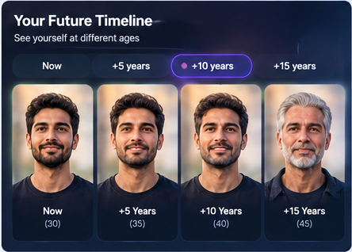

### 5. Lifestyle scenario comparison
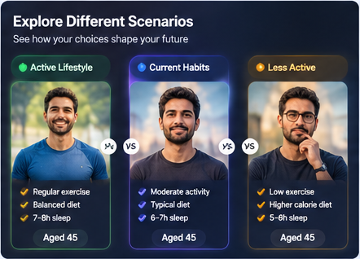

### 6. Future-self conversation
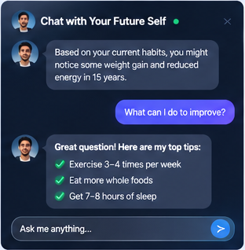

### 7. Personalised suggestions
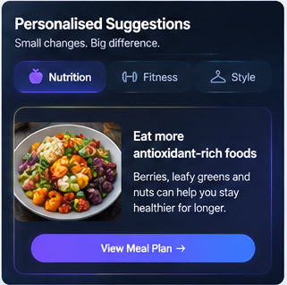

### 8. Persona profile
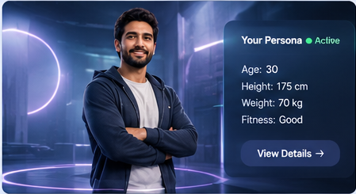

### 9. Technical architecture visual
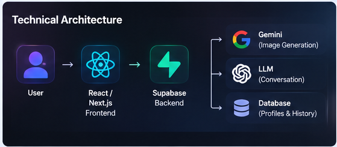

### 10. Key differentiators
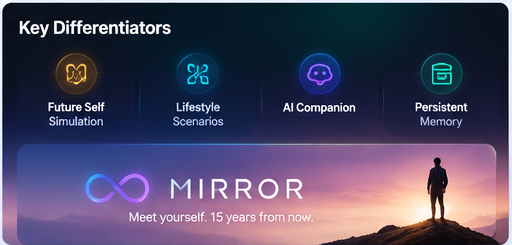

## Design guidance for Codex

- Aim for a premium, calm, cinematic interface: deep navy backgrounds, restrained violet/blue
  gradients, subtle glass surfaces, crisp typography, and generous spacing.
- Keep the user's current identity and selected future version as the visual focal point.
- Make timeline and scenario comparison controls obvious and easy to understand.
- Keep the floating companion useful but non-obstructive; draggable on desktop and compact on mobile.
- Ensure contrast, keyboard access, reduced-motion support, loading states, and responsive layouts.
- Treat all portraits in these references as illustrative generated concept art. Do not use them as
  real user identities or as evidence of model accuracy.
- Avoid copying any sample ages, heights, weights, health statements, or recommendations shown
  inside the mockups. Use user-provided data and safe, clearly qualified language.

## Asset map

| File | Intended use |
|---|---|
| `assets/mirror-concept-board.png` | Overall product direction / README preview |
| `assets/01-landing-page.png` | Hero and value proposition |
| `assets/02-onboarding.png` | Photo upload and profile setup |
| `assets/03-floating-companion.png` | Persistent companion component |
| `assets/04-future-timeline.png` | Age selector and timeline |
| `assets/05-scenario-comparison.png` | Side-by-side lifestyle scenarios |
| `assets/06-future-self-chat.png` | Companion conversation |
| `assets/07-personalised-suggestions.png` | Coaching/recommendation panel |
| `assets/08-persona-profile.png` | Persona summary card |
| `assets/09-technical-architecture.png` | High-level architecture inspiration |
| `assets/10-key-differentiators.png` | Product pillars / pitch slide |

## Using this pack in the Codex project

1. Extract `MIRROR_Codex_Project_Pack.zip` into the project root.
2. Keep `MIRROR_Codex_Brief.md` and the `assets/` directory together so the relative image links work.
3. Give Codex this instruction:

   > Read `MIRROR_Codex_Brief.md` completely before changing code. Treat it as the product brief
   > and use the images in `assets/` as visual references. First inspect the existing repository,
   > report the current stack and propose an implementation plan. Do not treat concept images as
   > production assets or as sources of factual health claims.

4. Commit the brief and assets to version control if they should remain available to the team.

